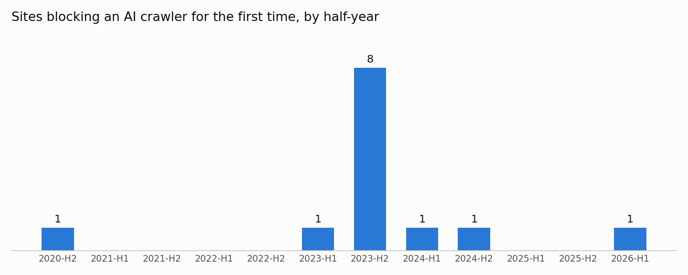

# robots.txt history study

How have websites changed their `robots.txt` rules in response to AI crawlers?
This project pulls every archived version of a site's `robots.txt` from the
Wayback Machine, reads each one the way RFC 9309 says a crawler should, and
tracks when each AI crawler was first named, blocked, or let back in.

## At a glance

- **Data:** 2,598 archived `robots.txt` versions from 19 sites (news, academic,
  government, forums, blogs), 2015 to 2026, checked against 23 crawler tokens
  from 11 companies.
- **Blocking is common and it arrived fast.** 13 of the 19 sites have blocked at
  least one AI crawler, including all 7 news sites. 8 of those 13 did so for the
  first time in the second half of 2023.
- **Sites separate training from search.** 11 sites currently block a company's
  training crawler while still allowing its search crawler; 5 do it with an
  explicit rule.
- **Rules keep moving.** 10 sites have unblocked an AI crawler at least once.

The tables behind these numbers are in `results/`. The code is `fetch.py`
(download), `robots_parser.py` (RFC 9309 parsing, 20 tests) and `analyze.py`
(tables); `plot_timeline.py` draws the chart above.

## Reproducing it

### Setup (once)

You need Python 3.9 or newer and one package:

    pip install requests

Then do two edits before the full run:

1. **Put your email in `USER_AGENT`** near the top of `fetch.py`. RFC 9309 asks
   crawlers to identify themselves, and this script is a crawler.
2. **Review `sites.csv`.** It has 22 starter sites across news, academic, forum,
   government and blog. Cut or swap whatever you like; the only required columns
   are `domain,category`.

### Run it

    python test_parser.py                      # 20 checks; should say 20/20 passed
    python fetch.py sites.csv --only npr.org   # test run on one site, ~1-2 min
    python fetch.py sites.csv                  # full run, roughly 30-90 min
    python analyze.py                          # a few seconds

The full run is safe to stop with Ctrl-C and restart with the same command: it
skips everything already downloaded. If you're short on time, add
`--max-dense 80` to the full run to cap each site at 80 recent versions.

### What you get

`data/raw/<domain>/<timestamp>.txt` holds each archived version. `data/manifest.csv`
records every capture considered and whether it was kept, rejected (and why) or
thinned. Then in `results/`:

| File | What it's for |
|---|---|
| `site_summary.csv` | One row per site: first AI mention, first AI block, what's blocked now, training/search split, default-deny, reversals |
| `ai_changes.csv` | Every change that affected an AI crawler, with before/after Wayback links. **Pick your close readings from here.** |
| `diffs/<domain>.txt` | Line-by-line diffs of each site's history; AI-relevant ones marked `[AI]` |
| `first_block_timeline.csv` | Sites first blocking an AI crawler, per half-year, by category |
| `snapshots.csv` | Every version with every tracked crawler's status |

## Method choices to state (and defend) in the paper

- **Change history, not snapshots.** The script asks the archive for each capture
  whose content differs from the one before it. Before July 2022 it keeps one
  version per year (the file as it stood at year's end); from July 2022 on it
  keeps every change, capped at 150 per site and thinned evenly beyond that. Dates
  are therefore accurate to how often the archive happened to capture the file.
- **Validation.** Captures that are HTML pages, empty, or contain no robots.txt
  directives are rejected and listed in the manifest. An empty `robots.txt`
  technically means "allow everything," so check rejected empty files by hand if
  one looks like it matters.
- **What "blocked" means.** Each file is read the way RFC 9309 says a crawler
  should read it (`robots_parser.py`), for one representative content path,
  `/news/2024/example-article`. A crawler is "blocked" if that path is disallowed
  for it. Change the path with `python analyze.py --path /some/other/path`.
- **Crawler roles are your judgment.** `bots.csv` labels each crawler as
  training, search, or user-triggered. Check each label against the company's own
  documentation before relying on it. `Google-Extended` and `Applebot-Extended`
  are opt-out tokens rather than separate crawlers.
- **Explicit vs. effective split.** "Effective" means a company's training crawler
  is blocked while its search crawler is allowed by any route, including just
  falling through to the `*` rules. "Explicit" also requires the file to name the
  search crawler, i.e. the site deliberately wrote a rule for it. The explicit
  version is the stronger evidence for your argument.

## Limitations to acknowledge

- The archive records the file *its* crawler was served. A site can serve
  different content to different user agents, so this isn't necessarily what
  GPTBot saw.
- Firewall and CDN blocking (e.g. Cloudflare's default) is invisible here. A file
  that "allows" a crawler may sit behind a firewall that blocks it.
- Archive coverage is uneven. Small sites have fewer captures, so their dates are
  less precise.

## Troubleshooting

- **"no archived captures found"**: try a different host in `sites.csv`, e.g.
  `www.example.com` or the subdomain that actually serves content.
- **Lots of "backing off" messages**: the archive is rate-limiting you. The script
  waits automatically; you can also raise `--delay` to 3.
